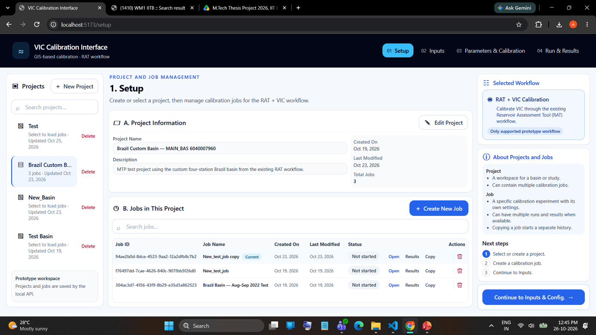
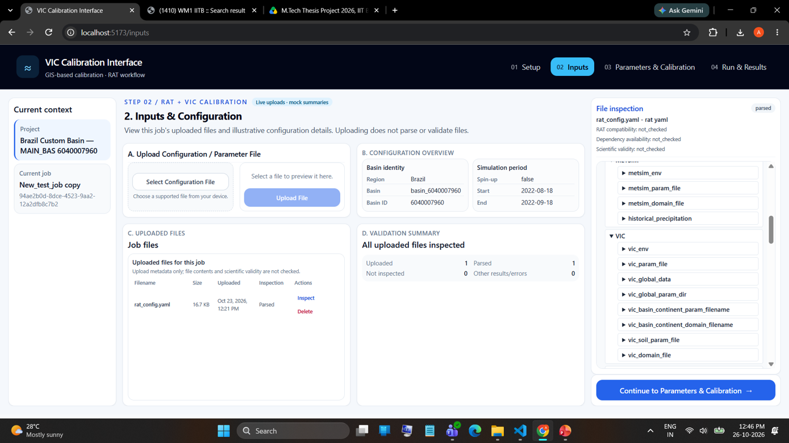
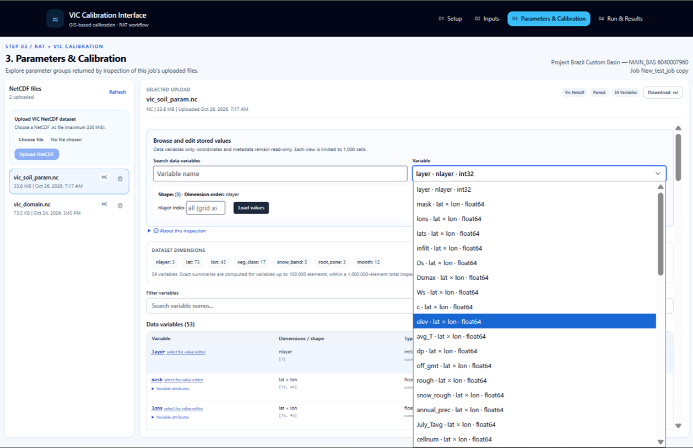

# VIC Calibration Interface

The **VIC Calibration Interface** is an open-source web GIS interface for inspecting, editing, and calibrating parameters of the **Variable Infiltration Capacity (VIC)** hydrological model within the **Reservoir Assessment Tool (RAT)** workflow. It is being developed incrementally: Stage I provides project/job organization and browser-based input and parameter inspection, while end-to-end scientific execution is planned for Stage II.

## Workflow abstraction

The interface is intended to bring VIC setup and analysis into one browser workflow:

**Configure → Run → Inspect, Visualize & Calibrate**

Rather than requiring users to move between manual VIC syntax configuration, GDAL raster conversions, and command-line NetCDF scripting, the interface provides a unified place to organize jobs, upload and inspect configuration and parameter data, and edit supported values. This abstraction is being built in stages: the current Stage I does not execute RAT/VIC workflows or provide scientific results; those execution and result views are planned.

## Four-tab interface

The primary navigation follows four workflow routes. The first three have Stage I functionality; **Run & Results** is a planned Stage II route.

1. **Setup** — Organize projects and basins, and create, open, copy, or delete calibration job records.

   

2. **Inputs & Configuration** — Upload and inspect RAT configuration files and manage input datasets associated with a selected job.

   

3. **Parameters & Calibration** — Browse uploaded multidimensional NetCDF datasets such as `vic_params.nc`, inspect values and grid indices across dimensions (including `nlayer`, `lat`, `lon`, `veg_class`, `snow_band`, `root_zone`, and `month`, when present), and edit parameter values in the interface.

   

4. **Run & Results** *(Planned — Stage II)* — Support end-to-end RAT execution (`MetSim → VIC → Routing`), spatial runoff visualization, and routed streamflow evaluation against observed gauge data. Execution and result generation are not implemented in Stage I.

## Technology stack

- **Frontend:** React, TypeScript, Vite, Tailwind CSS, and shadcn/ui conventions.
- **Backend:** FastAPI and Python, with xarray and netCDF4 for NetCDF dataset inspection and editing.
- **Local persistence:** SQLAlchemy with SQLite by default; uploaded files are stored under the backend's local storage directory.

## Repository structure

Generated caches and local runtime data are omitted from this overview. `backend/storage/` is gitignored and is created for the local SQLite database and uploaded files at runtime.

```text
frontend/
├── AGENTS.md
├── README.md
├── .env.example
├── package.json
├── package-lock.json
├── components.json
├── index.html
├── vite.config.ts
├── tailwind.config.js
├── postcss.config.js
├── tsconfig.json
├── tsconfig.app.json
├── tsconfig.node.json
├── prototype-1/
│   ├── tab-1-setup.png
│   ├── tab-2-inputs.png
│   └── tab-3-parameters-calibration.png
└── src/
    ├── App.tsx
    ├── main.tsx
    ├── index.css
    ├── vite-env.d.ts
    ├── features/
    │   ├── setup/
    │   │   ├── SetupPage.tsx
    │   │   ├── types.ts
    │   │   └── mockData.ts
    │   ├── inputs/
    │   │   ├── InputsPage.tsx
    │   │   ├── types.ts
    │   │   └── mockData.ts
    │   └── calibration/
    │       ├── CalibrationPage.tsx
    │       └── components/
    │           ├── InspectionViewer.tsx
    │           ├── NetCDFValueEditor.tsx
    │           ├── ParameterEditPanel.tsx
    │           ├── netcdfEditorState.ts
    │           ├── netcdfEditorState.test.mjs
    │           ├── valueRequestGuard.ts
    │           └── valueRequestGuard.test.mjs
    └── lib/
        ├── api.ts
        ├── inspectionState.ts
        ├── uploadEvents.ts
        └── utils.ts

backend/
├── .env.example
├── requirements.txt
├── app/
│   ├── __init__.py
│   ├── main.py
│   ├── db.py
│   ├── api/
│   │   ├── __init__.py
│   │   └── routes.py
│   ├── core/
│   │   ├── __init__.py
│   │   └── config.py
│   ├── models/
│   │   ├── __init__.py
│   │   └── records.py
│   ├── schemas/
│   │   ├── __init__.py
│   │   ├── inspection.py
│   │   ├── netcdf_editor.py
│   │   ├── parameter_drafts.py
│   │   └── records.py
│   └── services/
│       ├── __init__.py
│       ├── inspection.py
│       ├── netcdf_editor.py
│       ├── netcdf_inspection.py
│       ├── parameter_drafts.py
│       ├── record_deletion.py
│       └── uploads.py
└── tests/
    ├── conftest.py
    ├── test_api.py
    ├── test_inspection.py
    ├── test_netcdf_editor.py
    ├── test_netcdf_inspection.py
    ├── test_parameter_drafts.py
    ├── test_record_deletion.py
    ├── test_upload_deletion.py
    └── test_upload_filename_migration.py

docs/
└── images/
    ├── .gitkeep
    ├── tab-inputs.png
    ├── tab-parameters.png
    └── tab-setup.png
```

The `frontend/prototype-1/` images are design references. The `docs/images/` directory is reserved for exported presentation screenshots linked above.

## Local development

Run the backend and frontend in separate terminals. The frontend API client defaults to `http://127.0.0.1:8000`; the backend allows the Vite development origin at `http://localhost:5173`.

### Backend (PowerShell)

```powershell
cd backend
python -m venv .venv
.\.venv\Scripts\Activate.ps1
python -m pip install -r requirements.txt
python -m uvicorn app.main:app --reload
```

The backend uses SQLite and `backend/storage/` by default. To customize local settings, copy `.env.example` to `.env` within `backend/` and adjust the values there. The interactive API documentation is available at `http://127.0.0.1:8000/docs`.

### Frontend

In another terminal:

```powershell
cd frontend
npm install
npm run dev
```

Vite prints the local URL when the development server starts. To create and preview a production build:

```powershell
npm run build
npm run preview
```

## Current status and Stage II roadmap

### Stage I — implemented

- Create and manage projects and calibration job records through the FastAPI backend.
- Upload and inspect supported RAT configuration and job input files.
- Upload and inspect NetCDF datasets, browse multidimensional values, and save parameter edits.

These features inspect and edit user-provided files; they do not establish scientific validity or run MetSim, VIC, or Routing.

### Stage II — planned

- Resolve job-isolated workspace paths for RAT workflow inputs and outputs.
- Add asynchronous end-to-end RAT execution with live job status and log streaming.
- Cache meteorological spin-up data between suitable runs.
- Visualize spatial runoff and evaluate routed streamflow against observed gauges using NSE, KGE, and RMSE metrics.

## Acknowledgments

This project is developed as part of M.Tech research at the Centre of Studies in Resources Engineering (CSRE), IIT Bombay.

## License

Released under the [MIT License](LICENSE).
